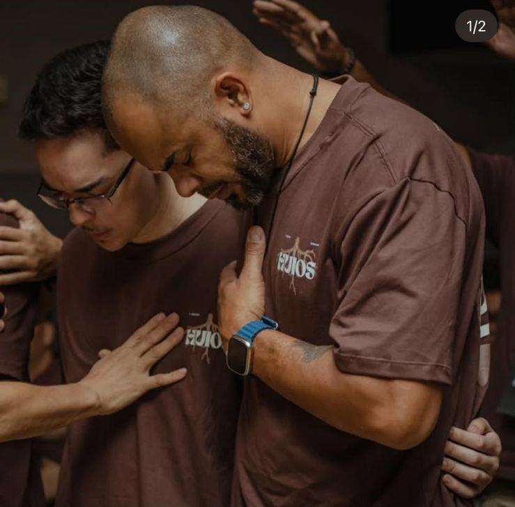

# Acessibilidade

 

[Índice](./README.md) ✦ [Frontend](../Codigo/frontend/README.md)

---

## Leitores de tela

Skip link · títulos dinâmicos · landmarks · labels · ARIA · FocusTrap · `role="alert"`

Testado: NVDA · JAWS · VoiceOver · TalkBack

---

## Surdez · baixa visão · mobilidade

Legendas em vídeos · barra de tamanho de texto · alto contraste · zoom livre · foco visível · teclado completo · `prefers-reduced-motion`

| Tecla | Ação |
|-------|------|
| Tab | Avançar |
| Enter / Espaço | Ativar |
| Esc | Fechar |

---

## Conteúdo

Vídeos legendados · `alt` em imagens · texto claro · links descritivos

Auditoria em dev: `@axe-core/react` no console.

---

