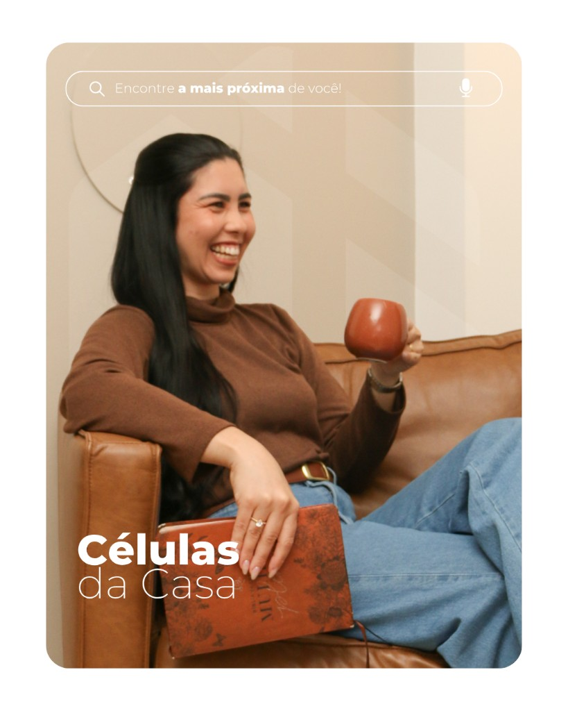

# Casa dos Discípulos

 

 

[Começando](./COMEÇANDO.md)
&nbsp;✦&nbsp;
[Arquitetura](./ARQUITETURA.md)
&nbsp;✦&nbsp;
[Hospedagem](./HOSPEDAGEM.md)
&nbsp;✦&nbsp;
[Custos](./RELATORIO_CUSTOS_E_DEPLOY.md)
&nbsp;✦&nbsp;
[Segurança](./SEGURANCA.md)

---

## Bem-vindo

Documentação completa da plataforma **Casa dos Discípulos** — do desenvolvimento local à produção — com a mesma linguagem visual do portal: teal, dourado e Montserrat.

  
  
  

---

## Navegação

### Começar

| Documento | Descrição |
|-----------|-----------|
| [Começando](./COMEÇANDO.md) | Instalar e rodar em desenvolvimento |
| [Arquitetura](./ARQUITETURA.md) | Stack, pastas e fluxos |

### Operação

| Documento | Descrição |
|-----------|-----------|
| [Hospedagem](./HOSPEDAGEM.md) | VPS, domínio, Docker, HTTPS |
| [Relatório de custos](./RELATORIO_CUSTOS_E_DEPLOY.md) | Gastos e tarefas para a liderança |
| [Segurança](./SEGURANCA.md) | Auth, rate limit, checklist |

### Produto

| Documento | Descrição |
|-----------|-----------|
| [Acessibilidade](./ACESSIBILIDADE.md) | WCAG 2.1 e inclusão |
| [WhatsApp](./WHATSAPP.md) | Notificações Evolution |
| [WhatsApp local](./CONFIGURAR_WHATSAPP_LOCAL.md) | Setup na máquina |
| [Especificação](./ESPECIFICACAO_E_PLANO_REFATORACAO.md) | Módulos e evolução |

### Código

| Documento | Descrição |
|-----------|-----------|
| [Backend](../Codigo/backend/README.md) | API Node.js |
| [Frontend](../Codigo/frontend/README.md) | React e marca |
| [Deploy](../deploy/README.md) | Compose e Nginx |
| [Assets](./assets/README.md) | Arte e logos |

---

## Módulos

| Módulo | Quem usa | Propósito |
|--------|----------|-----------|
| **Escola de Discípulos** | Membros e líderes | Módulos, quizzes e ranking |
| **Secretaria das Células** | Líderes e admin | Lições e formulários |
| **Eventos** | Todos | Carrossel e divulgação |
| **Fala Aí, Discípulo** | Todos | Devocional |
| **Escala** | Líderes e admin | Ministérios e calendário |
| **Gestão** | Admin | Usuários, células, níveis |

---

## Stack

| Camada | Tecnologias |
|--------|-------------|
| Frontend | React 18 · TypeScript · React Router 6 |
| Backend | Node.js · Express 5 · Knex · MySQL 8 |
| Auth | JWT · bcrypt · Helmet · rate limit |
| Notificações | Evolution API |
| Produção | Docker · Nginx · Let's Encrypt |

---

## Marca

| Token | Valor | Uso |
|-------|-------|-----|
| Teal | `#02869b` | Primária |
| Dourado | `#f4b002` | Destaque |
| Preto | `#0a0a0a` | Fundos e texto |
| Claro | `#ebebeb` | Superfícies |
| Fonte | **Montserrat** | UI e títulos |

  

---

## Caminhos rápidos

| Objetivo | Abra |
|----------|------|
| Rodar local | [Começando](./COMEÇANDO.md) |
| Entender o sistema | [Arquitetura](./ARQUITETURA.md) |
| Publicar | [Hospedagem](./HOSPEDAGEM.md) |
| Orçamento | [Custos](./RELATORIO_CUSTOS_E_DEPLOY.md) |

---

 

Casa dos Discípulos · Documentação · Outubro 2026

